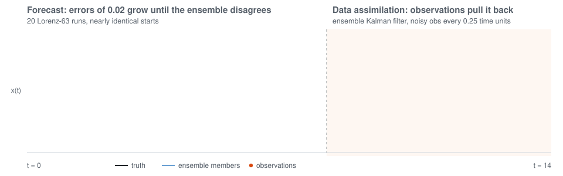

### Hi, I'm Eric Xu

I'm an M.S. student in Scientific Computing and Applied Mathematics at UC Santa Cruz (B.S. Applied Mathematics 2026). I build machine learning models for extreme weather prediction in the TACS Lab, advised by Prof. Ashesh Chattopadhyay, and I'm applying to PhD programs for Fall 2027.

<picture>
  <source media="(prefers-color-scheme: dark)" srcset="assets/ensemble-da-dark.svg">
  <source media="(prefers-color-scheme: light)" srcset="assets/ensemble-da-light.svg">
  
</picture>

*Chaos makes forecasts diverge; data assimilation pulls them back. A real Lorenz-63 ensemble with an EnKF, made by [ensemble_da.py](scripts/ensemble_da.py).*

**Now**
- Subseasonal (weeks 3 to 6) extreme weather forecasting with AI weather-model ensembles, TACS Lab
- Part-time ML researcher at Vayuh.ai: multi-GPU inference and benchmarking for extreme-event forecasts on H100s
- M.S. thesis (Plan I) and TA for AM 20 and AM 11A

**Selected projects**
- [invobs-data-assimilation](https://github.com/ericxu1070/invobs-data-assimilation): 4D-Var with a learned inverse observation operator in PyTorch; beat standard 4D-Var on Lorenz-96
- [DeepSEA-Transfer-Learning](https://github.com/ericxu1070/DeepSEA-Transfer-Learning): fine-tuning a human genomic model on mouse ENCODE data
- [council-of-sumer](https://github.com/ericxu1070/council-of-sumer): LLM advisors with conflicting goals debate and vote to run a city (UCSC AI Hackathon)

**Interests:** scientific ML, dynamical systems, GPU computing, quant finance

      

[Website](https://ericxu1070.github.io/) · [Resume](https://ericxu1070.github.io/resume.pdf) · [LinkedIn](https://linkedin.com/in/exu06) · ericxu1070 [at] gmail [dot] com
