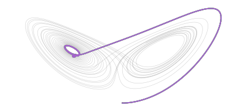

### Hi, I'm Eric

I'm doing a one-year M.S. in Scientific Computing and Applied Mathematics at UC Santa Cruz, where I also got my B.S. in applied math. I work in Ashesh Chattopadhyay's TACS Lab on forecasting extreme weather a few weeks ahead, and part-time at Vayuh.ai on the same problem. I'm applying to PhD programs for Fall 2027.

<picture>
  <source media="(prefers-color-scheme: dark)" srcset="assets/lorenz-dark.gif">
  <source media="(prefers-color-scheme: light)" srcset="assets/lorenz-light.gif">
  
</picture>

Five Lorenz-63 trajectories that start 0.00001 apart. They move together for a while, then split across the attractor. That sensitivity is why weather forecasts beyond a week or two are run as ensembles.

**Projects**
- [DeepSEA-Transfer-Learning](https://github.com/ericxu1070/DeepSEA-Transfer-Learning): fine-tuning DeepSEA, a genomic model trained on human data, on mouse data
- [council-of-sumer](https://github.com/ericxu1070/council-of-sumer): LLM advisors argue and vote on how to run an ancient city (UCSC AI Hackathon)
- [invobs-data-assimilation](https://github.com/ericxu1070/invobs-data-assimilation): our PyTorch reimplementation of Frerix et al. (ICML 2021), an AM 170B team capstone, 4D-Var with a learned inverse observation operator

      

[Website](https://ericxu1070.github.io/) · [Resume](https://ericxu1070.github.io/resume.pdf) · [LinkedIn](https://linkedin.com/in/exu06) · ericxu1070 [at] gmail [dot] com
